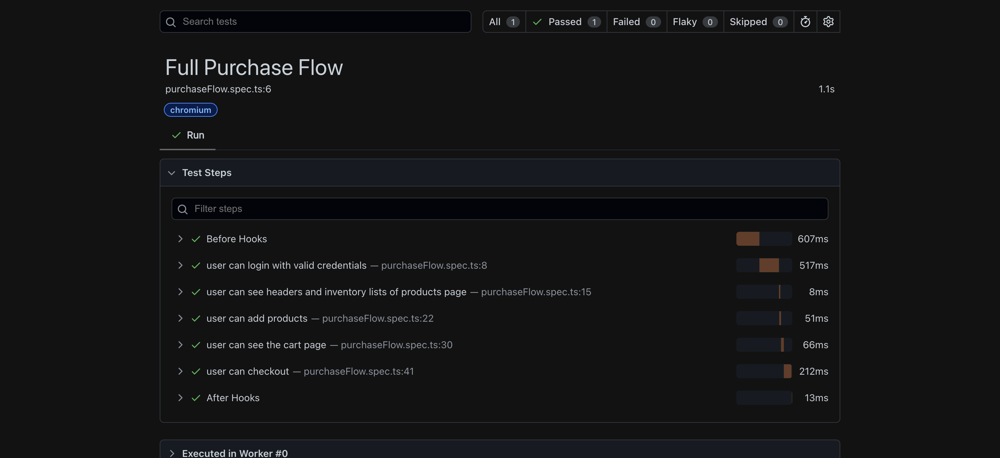

# SauceDemo Playwright Tests

End-to-end tests for [SauceDemo](https://www.saucedemo.com/) using Playwright and TypeScript.

## What's covered
A single end-to-end spec (`tests/purchaseFlow.spec.ts`), split into `test.step`s:
- **Login**: valid credentials
- **Products**: page headers, inventory list, add to cart
- **Cart**: added items are listed
- **Checkout**: fill info, review order, finish → order complete

## Tech & patterns
- Playwright Test + TypeScript (Chromium)
- Page Object Model (`pages/`)
- Custom fixtures (`fixtures.ts`)
- GitHub Actions CI with HTML report artifact

## Project structure
```
pages/          Page objects (Login, Products, Cart, Checkout)
tests/          Purchase flow spec
fixtures.ts     Injects page objects into tests
.github/        CI workflow
```

## Run locally
```bash
npm ci
npx playwright install --with-deps
npx playwright test
npx playwright show-report
```

## Test report
